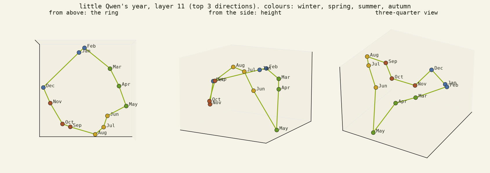

# 04 · rings and a position code

## In plain words

**Weekdays sit on a ring, at every layer.** Put each day in 24 sentences, average, and look at the best flat view: Mon → … → Sun in exact cyclic order at **all 24 layers**, already in the input embeddings. (By chance that order would turn up about once in 360 tries.) It closes with a wide **weekend seam**: Sun → Mon is a longer step than the rest. Months make a ring too (exact at 19 of 24 layers), but lumpier. *Predicted a ring in the middle layers: the ring held, "middle" didn't (it's there from layer 0).*

**The public SAE chops the ring up** (three's bet, and umber's): one main feature per day, features for neighbouring pairs (Sat–Sun, Mon–Tue…), and meaning features (Sunday "church", Sat–Sun "relaxing", Wednesday "work"). No feature holds the ring as a ring. A toy dictionary with one 2-D "ring" feature did order the days exactly, and fit a little better with two fewer parts.

**The surprise: days and months share a position code.** Monday looks like January, Tuesday like February, and so do the ordinals, number words and digits: "first", "one", "1", Monday and January share a direction (same-position cosine +0.39 to +0.55 vs about −0.07 for other pairs, p = 0.0003). Little Qwen counts its calendar: Monday is "1", Thursday is "4". Sunday splits between 7th and 1st: the week-start ambiguity.

**It's causal.** Add the ordinal step "fourth minus first" (learned from sentences about ordinals only, never days) to the day token, and the answer moves:
- "Today is Monday. Tomorrow is" → **Friday** (0.68), not Tuesday.
- 14 of 15 cases change at ×1–2; a random push of the same length changes 0–2.
- At ×2 every case lands on Friday or May: the push doesn't *add* 3, it *sets* the position to 4th, and the model computes "next" = 5th.

## A dial of twelve?

Months, clock hours and the twelve notes, in little Qwen:
- months: ring beats line (+0.82 vs +0.71). *Held.*
- clock hours: a number line beats a ring (+0.87 vs +0.52): twelve isn't next to one. *Held.*
- notes: the circle of fifths leads (+0.49), but faintly (p 0.016, no layer under 0.01); semitone order +0.30. *"Semitone beats fifths" didn't hold.*

**No helix for the year:** adding "height" (Jan low → Dec high) explains no more than a shuffled height does. The third direction is mostly May (also a verb) and Oct/Nov.

## Files

`ring.py`, `ring_sae.py` (toy ring dictionary), `cycles.py` (shared position code), `count_steer.py` (the causal push), `dial12.py`, `dial12_hf.py`, `dial12_score.py`.
