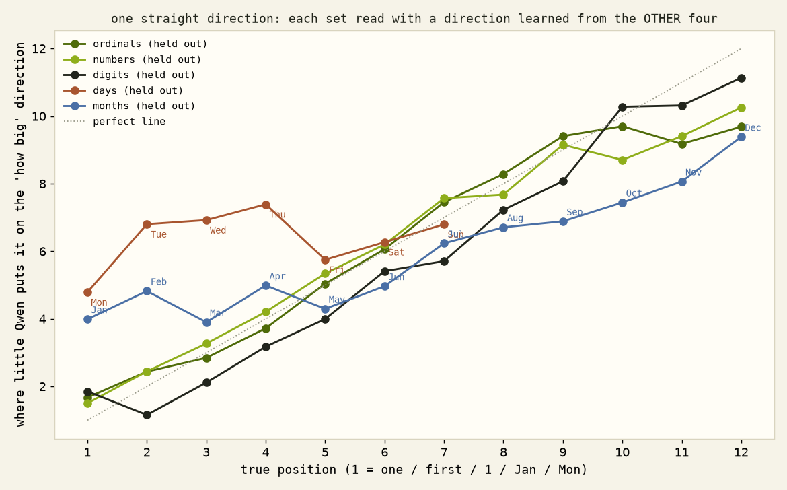
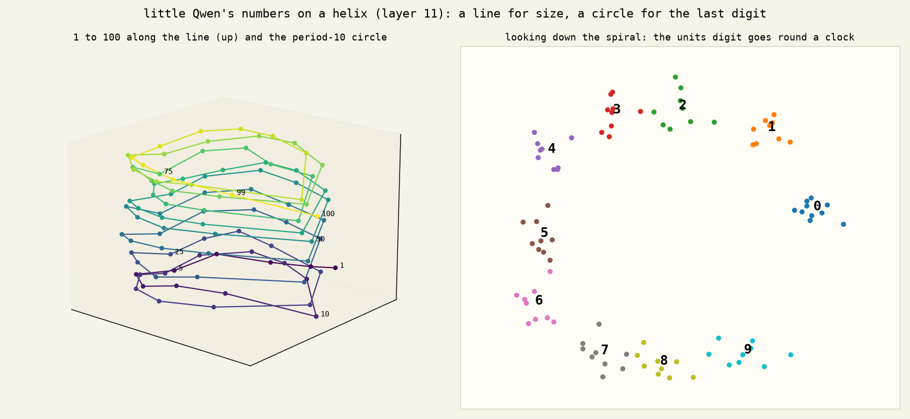

# 05 · adding by turning dials

## In plain words

How does a 0.8B model hold numbers, and can we steer its arithmetic?

**A straight "how big" line.** One direction, learned from four sets (ordinals, number words, digits, months, days), puts the fifth set in order: held-out r +0.94 to +0.99. Days are the exception (+0.33): the week is a ring, not a size. *Held.*

**Not quite a Weber log scale.** Distances look compressed overall, but the compression comes from the one-digit / two-digit boundary (1–9 are one token, 10–99 two), not a smooth log. Steps of ten are flat. *"Log beats linear" held only through that tokenizer confound.* Two-digit numbers form a rough grid of tens × units (additive 75%), and the round tens sit on a row of their own.

**Straight pushes don't add.** Pushing "one tens step" or "one units step" never produced +1 (0/24 for tens; the units push scrambles rather than steps). At ×8 the tens push jumps to a high digit (42+1 → 82). *Predictions didn't hold, twice.*

**Numbers sit on a helix.** A straight line for size plus circles with periods 10, 5, 2 and 100, the same periods Kantamneni & Tegmark found in bigger models. Held-out gains: period 10 +0.10, 5 +0.07, 2 +0.05, 100 +0.03; control periods 3 and 7 and a shuffled circle add nothing or hurt. *Predicted order held.*

**Turning the circles adds one.** At the last digit of "Calculate: 42 + 1 =", rotate every circle one notch forward: the answer becomes 44 in **17 of 24** sums (a random push of the same length: 0). It's the first steering of arithmetic that worked in little Qwen.

**Which circles do it?** Leave one out:

| circles turned | units moved +1 (of 24) |
|---|---|
| all four | 17 |
| without period 10 | 19 (no loss) |
| without period 5 | 7 |
| periods 2 + 5 only | 19 |
| period 5 alone | 18 (at twice the strength) |
| period 2 alone | 0–4 (never steps by itself) |

The even/odd circle and the period-5 circle are enough. Together, mod 2 and mod 5 fix mod 10 (the Chinese remainder theorem), so the model may hold the units digit as the pair (parity, remainder mod 5). Period 5 is the main dial; period 2 is a helper that halves the strength it needs.

**More notches:** +2 lands 16/18 at ×1, +3 12/18, −2 8/18 (random 0). *+2 and +3 held; −2 fell short.* At ×2 answers saturate into an attractor, so the clean evidence is ×1.

## Files

`numberline.py`, `weber.py`, `grid_steer.py`, `grid_steer2.py`, `rotate.py`, `rotate_drop.py`, `rotate_alone.py`, `rotate_k.py`; pictures `qwen-number-*.png`.
